# 動漫角色出現次數統計

共 80 張圖片，涵蓋 63 位角色；清單共 63 位角色，全部皆已出現。

已依原編號順序重新連續編為 `01` 至 `80`；巴麻美保留 `19`、`28`。

共有 16 位角色出現超過 1 次；只針對重複角色嵌入圖片預覽，單張角色不嵌入。

每張不同構圖各計 1 次；同名但不同作品的角色分開計算。

圖片編號對應 `動漫角色20261101-##.png`；角色 ID 沿用 `ANIME_CHARACTERS` 清單。

| 角色 ID | 角色 | 作品 | 次數 | 圖片編號 |
|---:|---|---|---:|---|
| 1 | 不知火舞 | 拳皇 | 2 | 26、42 |
| 2 | 春麗 | 快打旋風 | 1 | 09 |
| 3 | 嘉米 | 快打旋風 | 1 | 01 |
| 4 | 莫莉卡 | 魔域幽靈 | 1 | 67 |
| 5 | 艾薇 | 劍魂 | 1 | 29 |
| 6 | 多喜 | 劍魂 | 2 | 04、59 |
| 7 | 索菲緹亞 | 劍魂 | 1 | 34 |
| 8 | 卡桑德拉 | 劍魂 | 2 | 08、74 |
| 9 | 霞 | 生死格鬥 | 1 | 25 |
| 10 | 綾音 | 生死格鬥 | 1 | 45 |
| 11 | 安琪兒 | 拳皇 | 1 | 80 |
| 12 | 雪魯米 | 拳皇 | 1 | 47 |
| 13 | 蒂法 | 最終幻想VII | 2 | 23、49 |
| 14 | 艾莉絲 | 最終幻想VII | 2 | 18、37 |
| 15 | 優娜 | 最終幻想X | 2 | 24、41 |
| 16 | 露露 | 最終幻想X | 1 | 71 |
| 17 | 琉克 | 最終幻想X-2 | 1 | 32 |
| 18 | 焰 | 異度神劍2 | 1 | 39 |
| 19 | 光 | 異度神劍2 | 1 | 73 |
| 20 | 寄葉二號B型／2B | 尼爾：自動人形 | 1 | 50 |
| 21 | 優子 | 天元突破 紅蓮螺巖 | 1 | 63 |
| 22 | 波雅·漢考克 | 航海王 | 1 | 62 |
| 23 | 娜美 | 航海王 | 1 | 64 |
| 24 | 松本亂菊 | BLEACH 死神 | 1 | 57 |
| 25 | 孔雀舞 | 遊戲王 | 1 | 75 |
| 26 | 約兒·佛傑 | 間諜家家酒 | 1 | 20 |
| 27 | 艾爾莎·史卡雷特 | 妖精的尾巴 | 1 | 43 |
| 28 | 綱手 | 火影忍者 | 1 | 05 |
| 29 | 人造人18號 | 七龍珠Z | 1 | 14 |
| 30 | 式波·明日香·蘭格雷 | 福音戰士新劇場版 | 2 | 03、77 |
| 31 | 月野兔 | 美少女戰士 | 1 | 10 |
| 32 | 雷姆 | Re：從零開始的異世界生活 | 1 | 79 |
| 33 | 阿爾托莉雅／Saber | Fate/stay night | 1 | 35 |
| 34 | 初音未來 | VOCALOID | 1 | 78 |
| 35 | 峰不二子 | 魯邦三世 | 1 | 31 |
| 36 | 女亂馬 | 亂馬½ | 2 | 02、60 |
| 37 | 珊璞 | 亂馬½ | 1 | 44 |
| 38 | 久遠寺右京 | 亂馬½ | 1 | 33 |
| 39 | 天道茜 | 亂馬½ | 1 | 07 |
| 40 | 九能小太刀 | 亂馬½ | 3 | 16、27、36 |
| 41 | 拉姆 | 福星小子 | 1 | 56 |
| 42 | 弁天 | 福星小子 | 1 | 17 |
| 43 | 布瑪 | 七龍珠 | 1 | 40 |
| 44 | 蘭琪 | 七龍珠 | 1 | 61 |
| 45 | 妮可·羅賓 | 航海王 | 1 | 76 |
| 46 | 培羅娜 | 航海王 | 1 | 38 |
| 47 | 大和 | 航海王 | 1 | 52 |
| 48 | 日向雛田 | 火影忍者 | 1 | 53 |
| 49 | 地獄吹雪 | 一拳超人 | 1 | 65 |
| 50 | 戰慄的龍卷 | 一拳超人 | 1 | 12 |
| 51 | 桔梗 | 犬夜叉 | 2 | 11、58 |
| 52 | 珊瑚 | 犬夜叉 | 1 | 51 |
| 53 | 神樂 | 犬夜叉 | 2 | 13、54 |
| 54 | 日暮籬 | 犬夜叉 | 1 | 48 |
| 55 | 猿飛菖蒲 | 銀魂 | 1 | 70 |
| 56 | 來島又子 | 銀魂 | 2 | 15、68 |
| 57 | 神樂 | 銀魂 | 2 | 06、55 |
| 58 | 志村妙／阿妙 | 銀魂 | 1 | 72 |
| 59 | 鹿目圓 | 魔法少女小圓 | 2 | 22、46 |
| 60 | 曉美焰 | 魔法少女小圓 | 2 | 21、66 |
| 61 | 巴麻美 | 魔法少女小圓 | 2 | 19、28 |
| 62 | 美樹沙耶香 | 魔法少女小圓 | 1 | 30 |
| 63 | 佐倉杏子 | 魔法少女小圓 | 1 | 69 |

## 重複角色圖片比對

### 不知火舞（拳皇）

角色 ID：1；共 2 張；圖片編號：26、42。

| 26 | 42 |
| --- | --- |
|  |  |

### 多喜（劍魂）

角色 ID：6；共 2 張；圖片編號：04、59。

| 04 | 59 |
| --- | --- |
| 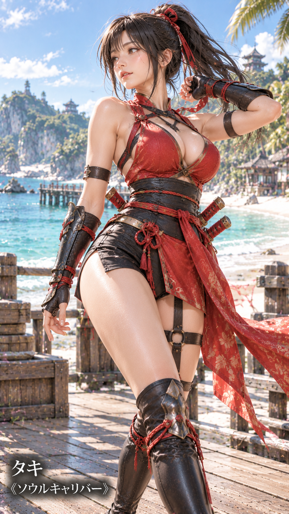 |  |

### 卡桑德拉（劍魂）

角色 ID：8；共 2 張；圖片編號：08、74。

| 08 | 74 |
| --- | --- |
| 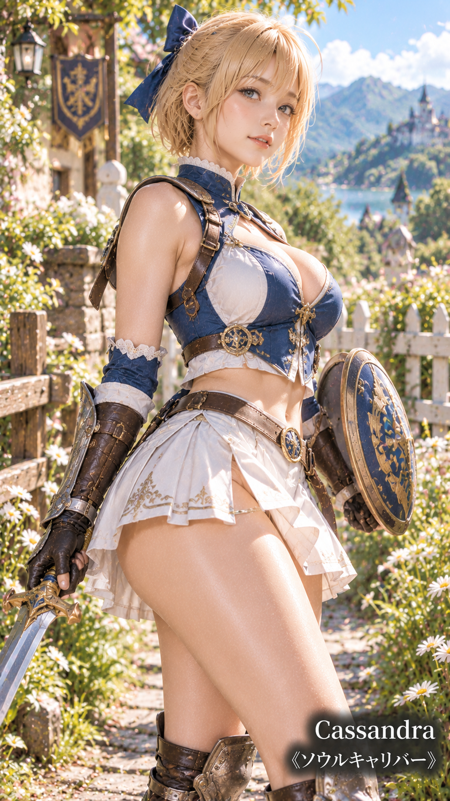 | 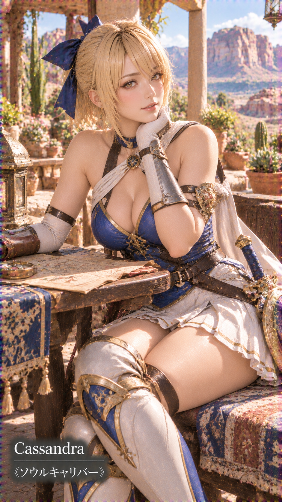 |

### 蒂法（最終幻想VII）

角色 ID：13；共 2 張；圖片編號：23、49。

| 23 | 49 |
| --- | --- |
| 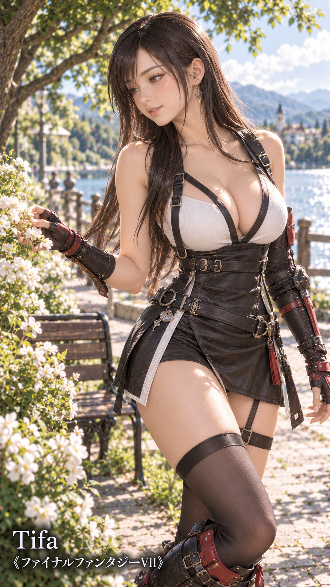 |  |

### 艾莉絲（最終幻想VII）

角色 ID：14；共 2 張；圖片編號：18、37。

| 18 | 37 |
| --- | --- |
|  |  |

### 優娜（最終幻想X）

角色 ID：15；共 2 張；圖片編號：24、41。

| 24 | 41 |
| --- | --- |
| 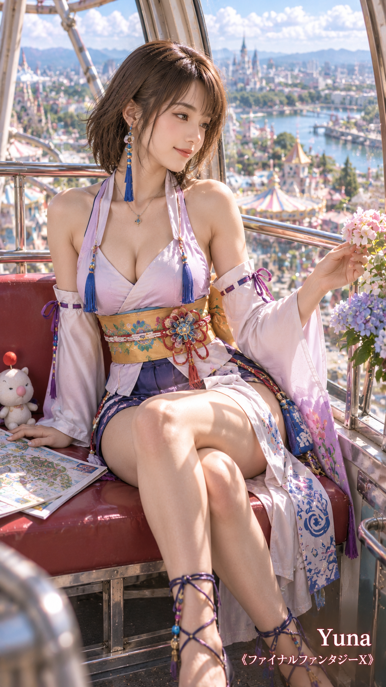 | 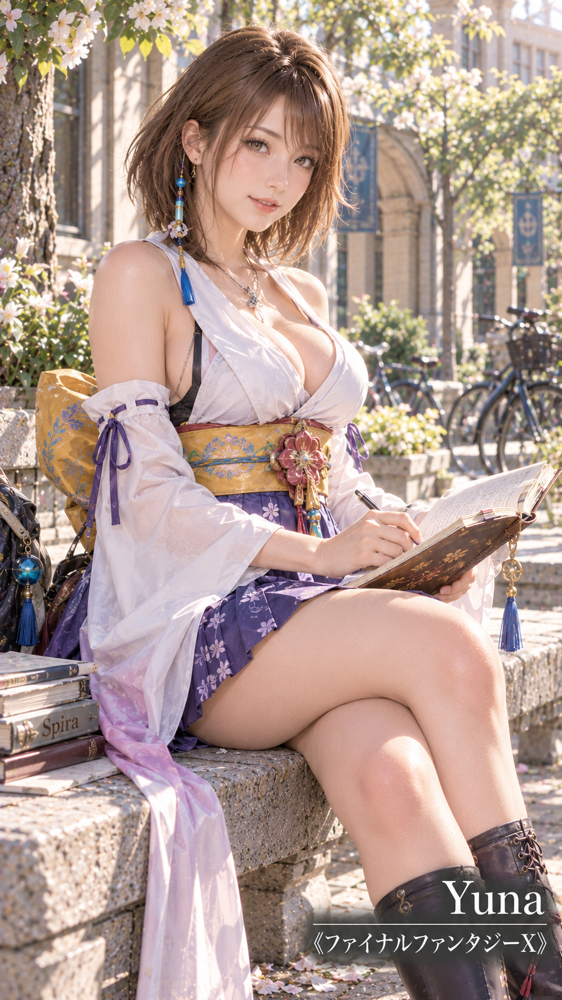 |

### 式波·明日香·蘭格雷（福音戰士新劇場版）

角色 ID：30；共 2 張；圖片編號：03、77。

| 03 | 77 |
| --- | --- |
|  |  |

### 女亂馬（亂馬½）

角色 ID：36；共 2 張；圖片編號：02、60。

| 02 | 60 |
| --- | --- |
|  | 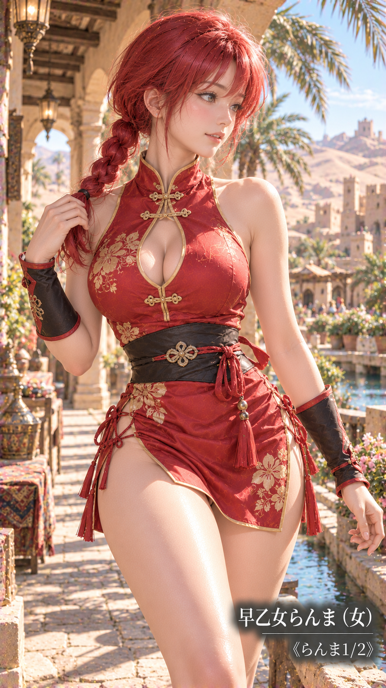 |

### 九能小太刀（亂馬½）

角色 ID：40；共 3 張；圖片編號：16、27、36。

| 16 | 27 | 36 |
| --- | --- | --- |
|  | 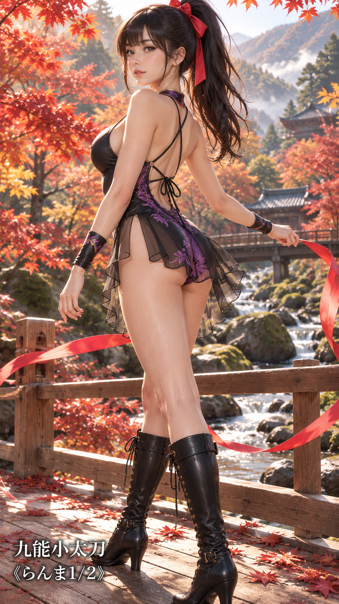 | 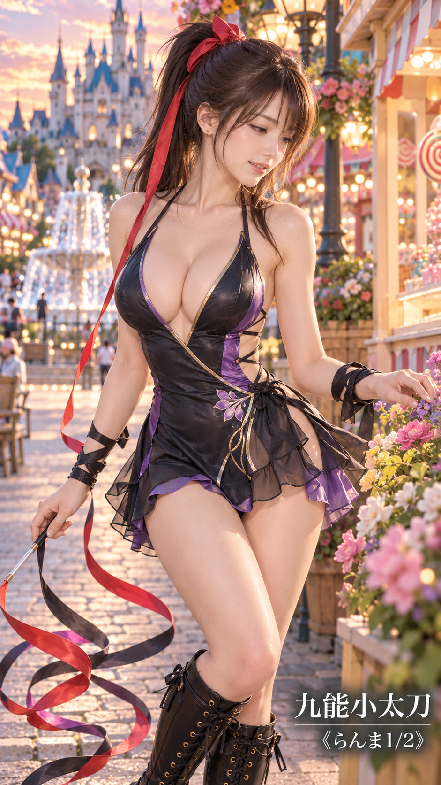 |

### 桔梗（犬夜叉）

角色 ID：51；共 2 張；圖片編號：11、58。

| 11 | 58 |
| --- | --- |
|  |  |

### 神樂（犬夜叉）

角色 ID：53；共 2 張；圖片編號：13、54。

| 13 | 54 |
| --- | --- |
|  | 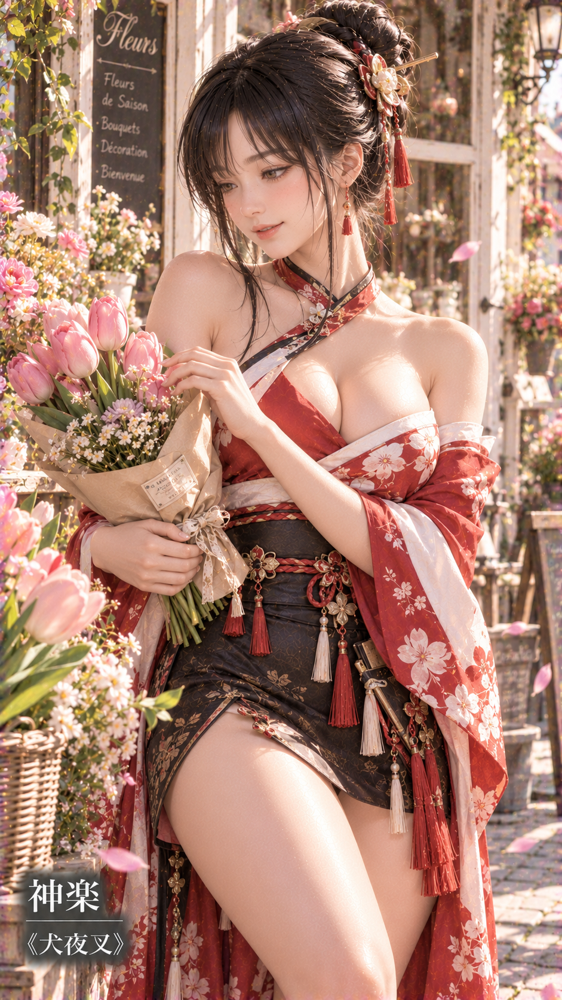 |

### 來島又子（銀魂）

角色 ID：56；共 2 張；圖片編號：15、68。

| 15 | 68 |
| --- | --- |
| 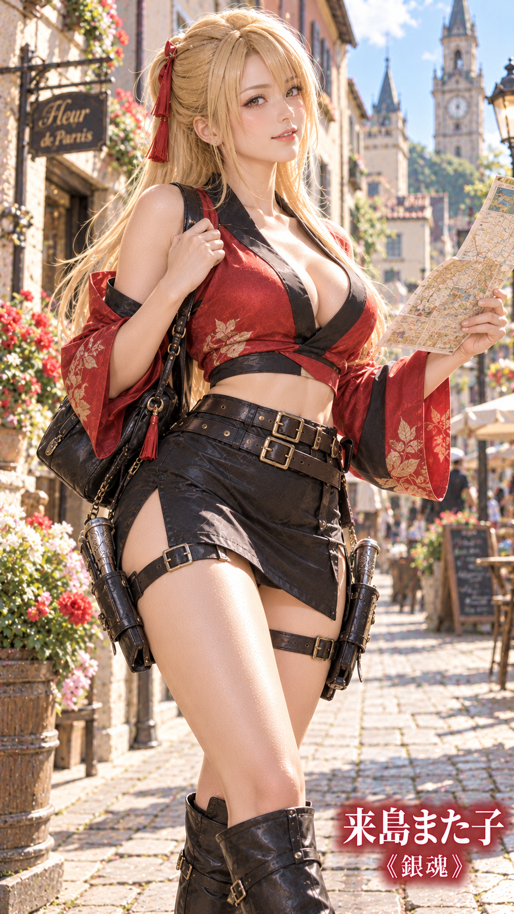 |  |

### 神樂（銀魂）

角色 ID：57；共 2 張；圖片編號：06、55。

| 06 | 55 |
| --- | --- |
|  |  |

### 鹿目圓（魔法少女小圓）

角色 ID：59；共 2 張；圖片編號：22、46。

| 22 | 46 |
| --- | --- |
| 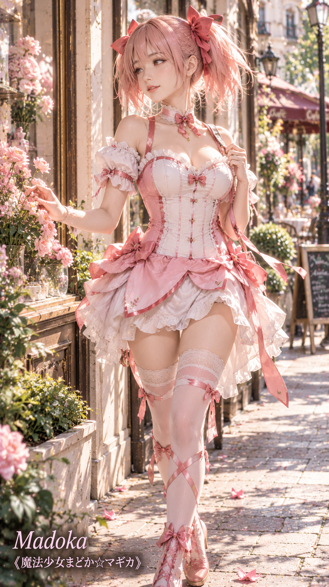 | 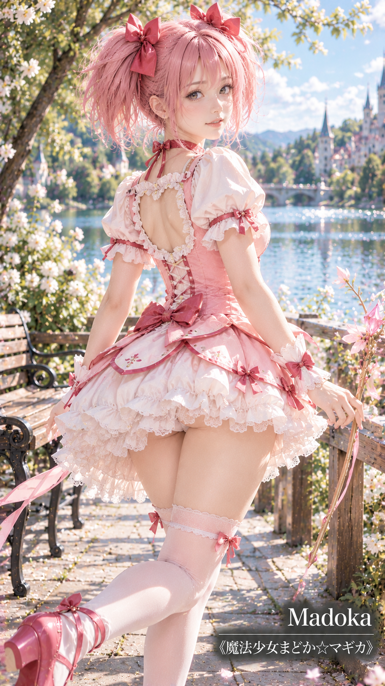 |

### 曉美焰（魔法少女小圓）

角色 ID：60；共 2 張；圖片編號：21、66。

| 21 | 66 |
| --- | --- |
|  |  |

### 巴麻美（魔法少女小圓）

角色 ID：61；共 2 張；圖片編號：19、28。

| 19 | 28 |
| --- | --- |
|  |  |

## 篩選保留版本（原始編號與目前編號）

原編號沿用前次選擇前的檔名，目前編號已同步本次重新編號。

| 角色 | 原編號 | 目前編號 |
|---|---|---|
| 春麗 | 18 | 09 |
| 嘉米 | 02 | 01 |
| 艾薇 | 57 | 29 |
| 霞 | 48 | 25 |
| 綾音 | 77 | 45 |
| 安琪兒 | 122 | 80 |
| 雪魯米 | 80 | 47 |
| 蒂法 | 42、82 | 23、49 |
| 焰 | 70 | 39 |
| 光 | 114 | 73 |
| 寄葉二號B型／2B | 83 | 50 |
| 優子 | 97 | 63 |
| 娜美 | 98 | 64 |
| 約兒·佛傑 | 35 | 20 |
| 艾爾莎·史卡雷特 | 74 | 43 |
| 綱手 | 10 | 05 |
| 人造人18號 | 25 | 14 |
| 式波·明日香·蘭格雷 | 07、118 | 03、77 |
| 月野兔 | 20 | 10 |
| 雷姆 | 120 | 79 |
| 初音未來 | 119 | 78 |
| 峰不二子 | 61 | 31 |
| 女亂馬 | 04、94 | 02、60 |
| 久遠寺右京 | 63 | 33 |
| 天道茜 | 13 | 07 |
| 九能小太刀 | 28、54、66 | 16、27、36 |
| 弁天 | 30 | 17 |
| 布瑪 | 71 | 40 |
| 妮可·羅賓 | 117 | 76 |
| 大和 | 85 | 52 |
| 日向雛田 | 86 | 53 |
| 地獄吹雪 | 100 | 65 |
| 珊瑚 | 84 | 51 |
| 猿飛菖蒲 | 108 | 70 |
| 來島又子 | 27、106 | 15、68 |
| 志村妙／阿妙 | 112 | 72 |
| 美樹沙耶香 | 60 | 30 |
| 佐倉杏子 | 107 | 69 |

巴麻美保留目前編號 `19`、`28`；先前移出的版本已備份。

統計範圍：目前「生成」目錄中 `動漫角色20261101` 系列的 80 張圖片。
